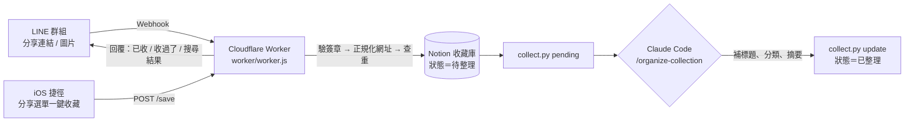

# LINE → Notion 收藏庫 bot

> A LINE bot on Cloudflare Workers that turns links and images shared in a group chat into a searchable Notion database, with URL de-duplication, keyword search inside LINE, an iOS Shortcut endpoint, and LLM-assisted categorization.

在社群上滑到想留的文章、餐廳、食譜，分享到 LINE 群組，bot 就會自動存進 Notion。之後由 AI 批次補上標題、分類和摘要，想找的時候直接在 LINE 打關鍵字查。

**實際運作成果**：2026-07 上線，多人共用至今。到 2026-10 已累積 **262 筆**收藏，其中 261 筆已完成整理，分成 9 個分類。每月營運成本 0 元（Cloudflare Workers、LINE 官方帳號和 Notion 都用免費方案）。

---

## 架構



| 元件 | 檔案 | 說明 |
|---|---|---|
| Webhook 與 API | `worker/worker.js` | 驗證 LINE 簽章，抽出網址和備註，取得分享者名稱，寫入 Notion，回覆結果；另外提供 iOS 捷徑用的 `/save` 端點 |
| 建庫 | `setup_db.py` | 一次性在指定的 Notion 頁面下建立資料庫和欄位 |
| 整理工具 | `collect.py` | `pending` 列出待整理項目，並盡力抓網頁的 title 和 og 描述；`update` 回寫整理結果；`retail` 輸出近 N 天的零售類收藏，供 [retail-news-pipeline](https://github.com/AsheCh/retail-news-pipeline) 當作額外來源 |
| AI 整理規則 | `claude/organize-collection.md` | Claude Code skill：分類定義、標題和摘要規則，讀不到內容時的處理方式 |

## 功能

- **收連結**：群組訊息裡有網址就收，可以順手加一句備註；沒有網址的訊息當作聊天，不會收。
- **收圖片**：從 LINE 下載圖片，透過 Notion File Upload API 上傳，再建立待整理項目。超過 5MB 會回覆告知沒收進去。
- **去重**：寫入前先把網址正規化，再查 Notion 有沒有收過，收過的會回覆「之前收過了」並附上原標題。正規化規則：
  - 去掉 `utm_*`、`fbclid`、`igsh`、`xmt` 等追蹤參數
  - Threads 和 Instagram 的網址整段 query 都去掉
  - TikTok 短網址先追轉址，取得真正的影片網址
- **在 LINE 裡查詢**：1 對 1 聊天打任何字都會搜尋；群組裡要用「找」或「查」開頭。依分類、標題、摘要和備註計分，回傳最相關的前 5 筆。
- **iOS 捷徑**：在分享選單點一下就收藏，不必開 LINE，用一組金鑰驗證。
- **AI 整理**：未整理的項目批次交給 Claude Code 判讀，補上標題、分類和摘要。IG、FB、Threads 常讀不到內容，這時改用備註和網域推斷，並在摘要裡註明。

## 設計重點

- **先回 200，背景再處理**：LINE webhook 等太久會判定逾時並重送，所以 Worker 收到後立刻回應，實際處理放在 `ctx.waitUntil` 裡跑。
- **收和整理分開**：bot 只負責「快速收、不漏收」；分類和摘要需要判斷力，交給 AI 批次處理。兩邊用 Notion 的「狀態」欄位銜接。
- **用 Notion 當資料庫**：不用另外架資料庫，收藏內容在手機和電腦上都能直接瀏覽、篩選和編輯。
- **欄位定義只有一份**：分類清單寫在 `setup_db.py`，由測試確保 `collect.py` 的分類白名單跟它一致。

## 設定步驟

1. **Notion**：建立一個 integration，把目標頁面分享給它，然後執行 `python3 setup_db.py <頁面連結>` 建立資料庫。
2. **LINE**：建立官方帳號，啟用 Messaging API，關閉自動回應，允許 bot 加入群組，再取得 Channel secret 和 access token。
3. **Cloudflare Worker**：
   ```bash
   cd worker
   npx wrangler login
   npx wrangler secret put LINE_CHANNEL_SECRET
   npx wrangler secret put LINE_CHANNEL_ACCESS_TOKEN
   npx wrangler secret put NOTION_TOKEN
   npx wrangler secret put NOTION_DATABASE_ID
   npx wrangler secret put SHORTCUT_KEY        # 選用：iOS 捷徑
   npx wrangler deploy
   ```
4. 把 deploy 印出的網址填到 LINE Developers 的 Webhook URL，按 Verify。接著建群組並邀 bot 加入，丟一個網址測試。

本機腳本的憑證放在 `.env`，格式見 `.env.example`。若想讓 bot 只收不回話，可以把 `ENABLE_REPLY` 設成 `0`。

## 測試

```bash
npm test                                   # Worker：網址正規化、查詢判斷、LINE 簽章驗證、搜尋計分
pip install -r requirements-dev.txt && pytest -q   # 腳本：Notion page ID 解析、分類與 schema 一致性
```

GitHub Actions 會在每次 push 時跑這兩組測試。
